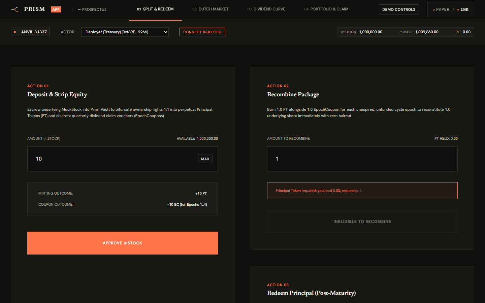
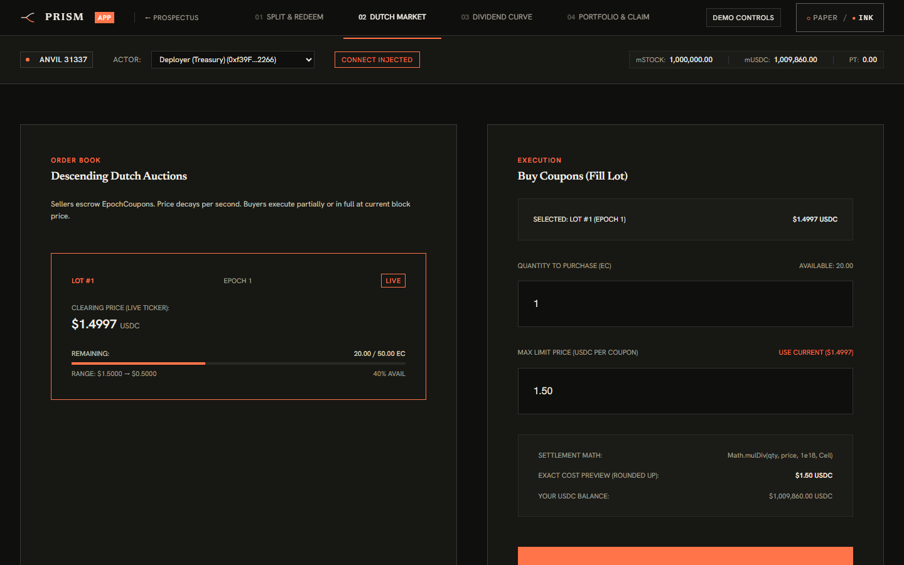
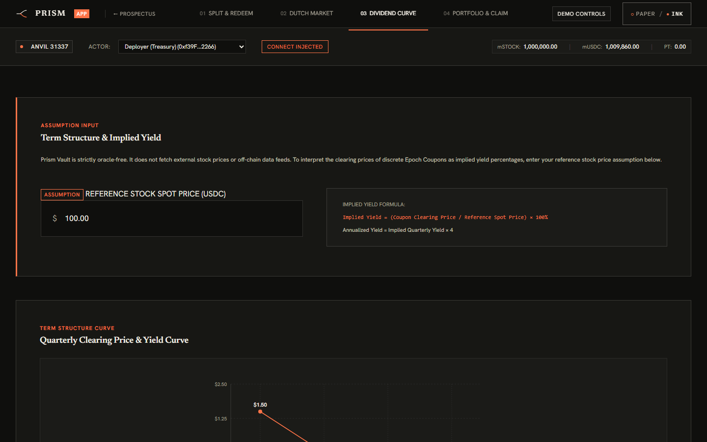
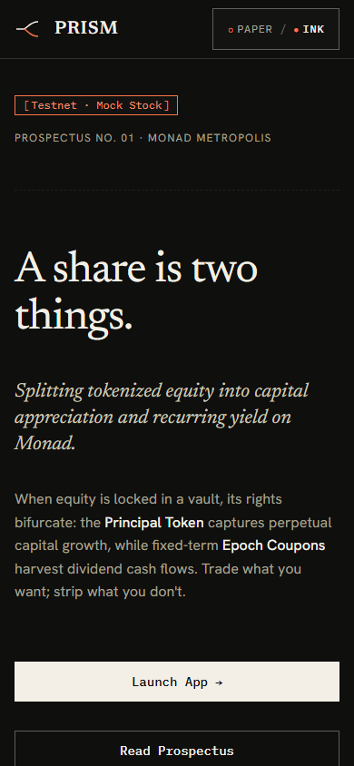
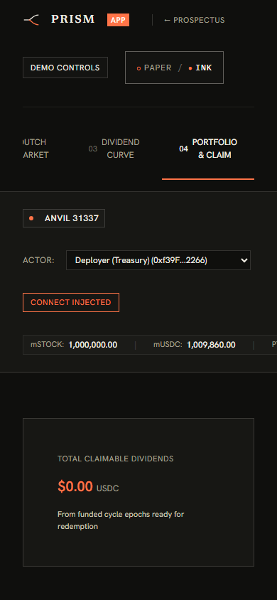

# Prism 🔺

> **Monad Metropolis — Track 1: Onchain Finance & Trading**  
> Splitting tokenized equity into pure capital appreciation (Principal Tokens) and recurring yield (Epoch Coupons).

---

## 1. Overview & Problem Fit

**Target User & Core Problem**:
- **Income-focused investors**: Want recurring cashflow and predictable quarterly dividend yield without exposure to equity market downturns or share price volatility.
- **Capital growth investors**: Want pure price appreciation and prefer to monetize upcoming quarterly dividend distributions for upfront liquid cash today rather than waiting months for disbursements.

**Prism** introduces a structural financial primitive for tokenized stocks on Monad. Inspired by traditional bond stripping and fixed-income STRIPS, Prism unbundles tokenized shares into two discrete, tradeable legs:

1. **Principal Token (`PPT`)**: An ERC-20 token representing pure price exposure to the underlying stock collateral, redeemable 1:1 for the underlying shares once distribution epochs conclude or recombined.
2. **Epoch Coupons (`EC`)**: An ERC-1155 multi-token collection (`id = epochId`) representing entitlement to specific quarterly dividend payouts. Holders can trade coupons on secondary markets to hedge dividend risk or speculate on dividend amounts.

### Strategy Comparison

| Strategy | Capital Exposure | Dividend Exposure | Upfront Cashflow | Asset Decoupling |
| :--- | :--- | :--- | :--- | :--- |
| **Sell the Stock** | Forfeited | Forfeited | 100% spot sale | Complete exit from asset |
| **Hold the Stock** | Retained | Delayed quarterly | Zero upfront | Bundled price + dividend volatility |
| **Generic Yield Stripping (Pendle-style)** | Continuous yield | Continuous linear APY (no ex-dates) | AMM LP liquidity | Tailored for DeFi lending/staking, not discrete corporate equity actions |
| **Prism** | **Pure Capital (`PPT`)** | **Discrete Quarters (`EC`)** | **Immediate via Dutch auction** | **Cleanly unbundled into independent risk legs** |

---

## 2. Architecture & Contracts

All contracts reside in [`contracts/`](contracts):

| Contract | Standard | Description |
|---|---|---|
| [`MockStock.sol`](contracts/MockStock.sol) | ERC-20 (18 dec) | Test collateral representing tokenized equity (with public mint). |
| [`MockUSDC.sol`](contracts/MockUSDC.sol) | ERC-20 (6 dec) | Test stablecoin representing dividend cashflow distributions. |
| [`IDividendSource.sol`](contracts/IDividendSource.sol) | Interface | Declares corporate actions (`DIVIDEND`, `SPLIT`, `OTHER`) and payout rates. |
| [`MockDividendSource.sol`](contracts/MockDividendSource.sol) | Ownable | Owner-controlled corporate action registry with strict action typing. |
| [`PrincipalToken.sol`](contracts/PrincipalToken.sol) | ERC-20 (18 dec) | Capital exposure leg. Mint and burn restricted exclusively to `PrismVault`. |
| [`EpochCoupon.sol`](contracts/EpochCoupon.sol) | ERC-1155 (Supply) | Per-epoch dividend coupons (`id = epochId`). Mint/burn restricted to `PrismVault`. |
| [`PrismVault.sol`](contracts/PrismVault.sol) | Vault Core | Coordinates deposits, epoch funding, claims, recombines, and principal redemptions. |
| [`PrismAuction.sol`](contracts/PrismAuction.sol) | Marketplace | Dutch auction marketplace for continuous EpochCoupon price discovery and liquidity. |

---

## 3. Core Lifecycle & Mechanics

```
                         ┌──────────────┐
                         │  MockStock   │
                         └──────┬───────┘
                                │ deposit(amount)
                                ▼
                       ┌─────────────────┐
                       │   PrismVault    │
                       └───┬─────────┬───┘
                           │         │
          mints Principal  │         │ mints EpochCoupons
                           ▼         ▼
                  ┌─────────────┐   ┌──────────────────────────┐
                  │PrincipalToken│  │EpochCoupon (id = 1, 2, 3)│
                  └─────────────┘   └────────────┬─────────────┘
                                                 │
                   Secondary market transfer ────┤
                                                 ▼
                  fundEpoch(epochId) ──► claim(epochId, amount) ──► MockUSDC Payout
```

### 1. Epoch Creation (`createEpoch`)
- The vault admin registers distribution epochs with strict validation:
  - The schedule is fixed before the first deposit. Once the vault is sealed (automatically on the first `deposit` or early via `seal()`), `createEpoch` reverts with `EpochsSealed()`.
  - Bounded epochs: maximum `MAX_EPOCHS = 16` distribution epochs.
  - Bounded horizon: `exDate` cannot exceed `block.timestamp + MAX_EPOCH_HORIZON` (400 days).
  - `exDate` must be strictly in the future (`> block.timestamp`).
  - `payDate` must be on or after `exDate`.
  - Consecutive `exDate` values must be strictly increasing.

### 2. Deposit (`deposit`)
- A user locks `amount` of `MockStock` into `PrismVault`.
- On first deposit, the vault permanently seals the epoch schedule (`isSealed = true`).
- The vault mints `amount` of `PrincipalToken` to the user.
- The vault mints `amount` of `EpochCoupon` **only for live epochs** (`!epoch.funded && epoch.exDate > block.timestamp`). Already funded or expired epochs are skipped to protect dividend solvency.

### 3. Corporate Action Safeguard, Event Locking & Funding (`fundEpoch`)
- The dividend source declares an event for an epoch (`DIVIDEND`, `SPLIT`, or `OTHER`).
- In `MockDividendSource`, the owner can re-declare corporate actions to correct errant declarations prior to calling `lockEvent(epochId)`. Once `lockEvent` is called, the declaration is permanently immutable (`EventLocked`).
- When `fundEpoch(epochId)` is called:
  - Requires the corporate action event to be explicitly locked (`EventNotLocked` revert otherwise), ensuring declarations cannot be altered post-funding.
  - If the action type is **not** `DIVIDEND` (e.g. a `SPLIT` or `OTHER`), the transaction **reverts** (`NonDividendActionType`). The owner can re-declare before locking to fix errors.
  - **Demo Mode Safeguard**: The vault's `demoMode` is initialized via constructor argument (default `true` only on testnet deployment). `setDemoMode` is strictly **one-way**: it can only disable demo mode (`false`). Re-enabling demo mode reverts (`CannotEnableDemoMode`). When disabled, `fundEpoch` before `exDate` reverts (`ExDateNotReached`).
  - Calculates required payout: `(couponSupply(epochId) * usdcPerShare) / 1e18`, where `usdcPerShare` is the dividend amount in USDC base units (6 decimals) per whole share (1e18 units).
  - Pulls `MockUSDC` from caller into the vault.
  - Marks epoch state as `CLAIMABLE`.

### 4. Claiming Dividend Yield (`claim`)
- Any coupon holder (original depositor or secondary market buyer) calls `claim(epochId, amount)`.
- Burns the specified amount of `EpochCoupon`.
- Transfers pro-rata `MockUSDC` to the caller: `(amount * totalFundedUSDC) / fundedSupply`.

### 5. Recombination (`recombine`)
- At any time, a user can reconstitute their underlying `MockStock` collateral by calling `recombine(amount)`.
- Burns `amount` of `PrincipalToken`.
- Burns `amount` of `EpochCoupon` for all **live epochs** (`!epoch.funded && epoch.exDate > block.timestamp`).
- **Funding Grace Period (`FUNDING_GRACE = 30 days`)**: Past-`exDate` epochs that are unfunded block `recombine` (which would otherwise bypass them) until the epoch is funded OR the 30-day grace period has elapsed (`block.timestamp >= exDate + FUNDING_GRACE`). This incentivizes principal holders or market makers to ensure coupon holders receive their declared dividends before principal can be reclaimed.

### 6. Principal Redemption (`redeemPrincipal`)
- When no live distribution epochs remain (`hasFutureEpochs() == false`), principal can be redeemed directly.
- **Grace Period Check**: Reverts with `EpochAwaitingFunding` if any past-`exDate` epoch remains unfunded within the 30-day grace period. Once funded or once the 30-day window expires, principal redemption unblocks.
- Burns `amount` of `PrincipalToken` and returns `amount` of `MockStock`.

### 7. Collateral Support & Limitations
- `PrismVault.deposit` verifies actual token transfer deltas (`balanceAfter - balanceBefore == amount`) and reverts with `UnsupportedCollateral()` for any non-standard behavior.
- **Unsupported Tokens**: Rebasing tokens (e.g. stETH), fee-on-transfer tokens, and balance-multiplier tokens are strictly unsupported as raw collateral.
- In production, non-standard collateral must be wrapped via an ERC-4626 or dedicated vault collateral wrapper adapter before deposit.

### 8. Governance & Security
- Contracts (`PrismVault`, `MockDividendSource`) inherit OpenZeppelin `Ownable2Step`.
- Any non-demo / production deployment must transfer protocol ownership to a multi-signature wallet (e.g., Safe) or a timelock controller to avoid single-owner compromise.

---

## 4. Dividend Dutch Auction (`PrismAuction`)

The **Prism Dividend Dutch Auction** provides continuous on-chain price discovery and secondary liquidity for coupon holders wishing to sell upcoming dividend rights before the ex-dividend date.

### Core Auction Mechanics
- **Escrow**: Sellers deposit `EpochCoupon` into [`PrismAuction.sol`](contracts/PrismAuction.sol).
- **Linear Decay**: Prices decay continuously per second from `startPrice` to `floorPrice` over `duration` seconds:
  $$P(t) = \text{startPrice} - \frac{(\text{startPrice} - \text{floorPrice}) \times \Delta t}{\text{duration}}$$
  Once $t \ge \text{duration}$, the price clamps deterministically at `floorPrice`.
- **Immediate Settlement**: Buyers purchase coupons using `MockUSDC`. USDC is transferred directly from the buyer to the seller, and coupons are delivered to the buyer instantly.
- **Order Sizing & Direct Self-Trade Guard**: `buy` enforces `MIN_FILL = 1e15` (0.001 coupon) unless filling the entire remaining auction balance (`FillBelowMinimum` revert). Direct `buyer == seller` self-trading is blocked with `SelfTrade()`.
- **Informational Volume-Weighted Average Price (VWAP)**: `PrismAuction` tracks cumulative `epochNotional` (total USDC paid) and `epochVolume` (coupons filled). Sybil wash trading across distinct addresses cannot be prevented purely on-chain; therefore, the VWAP is **strictly informational** and must never be consumed by external contracts as a price feed.
- **Slippage Protection**: Buyers pass `maxPrice` to ensure execution does not exceed their slippage threshold.
- **Batch Auctions**: Sellers can call `createBatchAuctions` to bundle multiple quarters into a single transaction.
- **Zero Protocol Fees (MVP)**: This MVP implementation features zero protocol fees, providing 100% of proceeds directly to the seller.

---

## 5. Dividend Sourcing: Testnet Mechanics vs. Production

> [!IMPORTANT]
> **Testnet Incentive Mechanism vs Production Reality**
>
> In this testnet deployment:
> - Dividend announcements and execution rely on `MockDividendSource` and a permissionless `fundEpoch` function with a **30-day Funding Grace Period** (`FUNDING_GRACE = 30 days`).
> - If an epoch passes its `exDate` without being funded, principal redemptions and recombines are blocked for up to 30 days. This creates an economic incentive on testnet for principal holders or issuers to pay the declared dividend to coupon holders or wait out the grace period.
> - Once the 30-day grace period lapses without funding, the epoch is flagged as defaulted (emitting `FundingDefaulted(epochId)`), and principal redemptions safely unblock.
> - **This is a testnet incentive mechanism, not a replacement for real institutional dividend custody.**

### How Real Tokenized Stocks Pay Dividends
Real-world tokenized equities handle corporate distributions through three distinct models:
- **xStocks**: Distributes dividends via a balance multiplier (rebasing ERC-20), credited net of standard 30% statutory withholding tax.
- **Ondo**: Operates as a total-return fund where dividend proceeds are reinvested into underlying asset NAV, accreting into token price rather than being distributed as discrete cash payments.
- **Dinari**: Disburses stablecoin payouts directly to verified KYC'd wallets upon corporate action record dates, deducting a 5% processing fee.

**Prism Protocol Alignment**:
- Prism's **cash-funded mode** directly models the **Dinari-style** case: declared cash dividends are funded in USDC per share with net-of-withholding tax accounting.
- Prism's **in-kind capture mode** directly targets the **xStocks-style** case: surplus rebasing stock collateral from corporate actions is captured and distributed in kind to coupon holders.

### Production Dividend Sourcing Architecture
In a production deployment on Monad, dividend distribution cannot rely on voluntary principal escrow blocking. Instead, real-world tokenized equities require one of the following production architectures:
1. **Custodian / Issuer Direct Push**:
   The tokenized equity issuer (e.g. Backed, Dinari, Ondo) or an authorized broker-dealer custodian automatically pushes USDC directly to `PrismVault.fundEpoch` upon corporate action payment dates via DTCC-integrated clearing channels.
2. **Rebasing / Yield-Accruing Collateral Adapter**:
   The vault wraps the underlying equity in a rebasing or share-appreciating collateral adapter (e.g. ERC-4626). Dividend payments increase the adapter's underlying assets, allowing the vault contract itself to harvest and liquidate the yield directly into USDC distributions.
3. **Decentralized Corporate Action Oracle**:
   Independent oracle feeds (e.g. Chainlink Functions, Pyth, API3 Airnode) read DTCC / Bloomberg corporate action records and verify on-chain that dividend declarations, ex-dates, and per-share amounts match external regulatory filings.

---

## 6. Stateful Invariant Testing

Prism runs stateful invariant testing via Foundry (`test/Invariants.t.sol`), configured with `runs = 256` and `depth = 50` (12,800 random actor interactions per run) across 3 distinct actors performing random deposits, recombines, funding, claims, auctions, buys, time warps, and owner administration (declare, lock, seal, demo mode, pause/unpause):

1. **Collateral Conservation**:
   $$\text{MockStock.balanceOf}(\text{Vault}) \ge \text{PrincipalToken.totalSupply}()$$
   (The vault holds at least 1:1 underlying collateral for every outstanding Principal Token across all execution sequences).
2. **Coupon Supply Exact Equality (Live Epochs)**:
   $$\forall e \in \text{Epochs}_{\text{live}}, \quad \text{EpochCoupon.totalSupply}(e) + \text{auctionEscrow}(e) \equiv \text{PrincipalToken.totalSupply}()$$
   (Every outstanding Principal Token has exactly 1 matching Epoch Coupon across circulating and escrowed balances for live distribution epochs).
3. **Dividend Solvency Invariant**:
   $$\text{MockUSDC.balanceOf}(\text{Vault}) \ge \sum \text{unclaimedFundedPayouts}$$
   (The vault's USDC reserves are guaranteed to cover all claimable funded dividend liabilities).
4. **Auction Escrow Accounting**:
   $$\text{EpochCoupon.balanceOf}(\text{Auction}, e) \equiv \sum_{\text{active}} \text{remainingAmount}(e)$$
   (Coupons escrowed in the auction contract exactly match the sum of active auction order volumes).
5. **Dividend Claim Cap**:
   $$\forall e, \quad \text{totalClaimedUSDC}(e) \le \text{totalFundedUSDC}(e)$$
   (Total USDC claimed for any epoch can never exceed the amount funded).
6. **Locked Dividend Immutability**:
   A locked dividend corporate action event can never be altered or re-declared.
7. **Stock Redemption Bound**:
   No address can redeem more underlying stock collateral than its minted or held Principal Token balance.

---

## 7. Build, Test, & Gas Reports

### Prerequisites
- [Foundry](https://getfoundry.sh/) (`forge`, `cast`)
- Solidity `^0.8.24`

### Clone & Dependencies
```bash
git clone --recurse-submodules https://github.com/Arnav0107/Prism.git
cd Prism

# If cloned without --recurse-submodules:
git submodule update --init --recursive
# Or install directly via forge:
forge install OpenZeppelin/openzeppelin-contracts@v5.1.0
```

### Build
```bash
forge build
```

### Run Tests
```bash
forge test -vv
```

### Run Invariant Fuzzing & Gas Report
```bash
forge test --gas-report
```

---

## 8. Deployment to Monad Testnet

1. Copy `.env.example` to `.env`:
   ```bash
   cp .env.example .env
   ```
2. Configure your `RPC_URL` and `PRIVATE_KEY`.
3. Execute the deployment script:
   ```bash
   forge script script/Deploy.s.sol:DeployScript \
     --rpc-url https://testnet-rpc.monad.xyz \
     --broadcast
   ```

The script will:
1. Deploy `MockStock`, `MockUSDC`, and `MockDividendSource`.
2. Deploy `PrismVault` (which automatically deploys `PrincipalToken` and `EpochCoupon`).
3. Initialize 4 quarterly epochs (Q1 to Q4).
4. Mint test balances of 1,000,000 `mSTOCK` and 1,000,000 `mUSDC` to the deployer.

---

## 9. Web Application & Design System

The official prospectus landing page is located in [`web/`](web).

### Design Philosophy
- **Editorial Prospectus**: Rejects crypto-startup cliches (no blue, no purple neon, no gradients, no glassmorphism).
- **Core Motif**: The split-line hairline mark dividing incoming shares into Principal (top/ink) and Coupon (bottom/vermilion).
- **Typography**: Self-hosted `Newsreader` (display serif), `Hanken Grotesk` (body sans), and `IBM Plex Mono` (tabular numbers).
- **Performance**: Lean, fast-loading bundle (~178KB total gzip weight across JS and CSS), zero layout shift, responsive down to 360px.
- **Accessibility**: WCAG AAA/AA color contrast, keyboard skip link (`#main-content`), 44px minimum touch targets, and full `prefers-reduced-motion` compliance.

Detailed design system tokens and component specs are documented in [`docs/DESIGN_SYSTEM.md`](docs/DESIGN_SYSTEM.md).

### Run Locally

Run the complete Prism stack locally on an Anvil chain with 3 commands:

```bash
# 1. Install dependencies
npm --prefix web install

# 2. Deploy contracts and seed epochs to local Anvil (spawns Anvil if not running)
bash script/DeployLocal.sh    # On Windows: powershell -File script/DeployLocal.ps1

# 3. Start local web application
npm --prefix web run dev
```

Visit `http://localhost:5173/` for the prospectus and `http://localhost:5173/#/app` for the live trading application.

To run the automated end-to-end integration lifecycle against local Anvil:
```bash
node web/scripts/e2e-local.mjs
```

### Local Architecture

```
┌────────────────────────────────────────────────────────┐
│             Prism Web Application (Vite)               │
│                                                        │
│  Route /#/     : Prospectus Landing Page               │
│  Route /#/app  : Working Terminal (Chain ID 31337)     │
│  - Split & Redeem (Deposit stock, Mint PT & EC)       │
│  - Dutch Market (1s live decay price ticker, buys)    │
│  - Dividend Curve (Term structure, implied yield)     │
│  - Portfolio & Claim (Pro-rata dividend settlement)   │
│  - Simulation Drawer (Faucet mint, declare dividend)  │
└───────────────────────────┬────────────────────────────┘
                            │ Viem RPC & Event Indexing
                            ▼
┌────────────────────────────────────────────────────────┐
│             Local Anvil Node (Chain 31337)             │
│                                                        │
│  Contracts:                                            │
│  - PrismVault (Collateral lock, PT & EC minting)       │
│  - PrismAuction (Dutch auctions, mulDiv ceil math)     │
│  - PrincipalToken (ERC-20 capital leg)                 │
│  - EpochCoupon (ERC-1155 dividend claim vouchers)      │
│  - MockStock & MockUSDC (Test tokens)                  │
│  - MockDividendSource (Oracle corporate action fixture)│
└────────────────────────────────────────────────────────┘
```

- **Local Chain (Anvil 31337)**: Runs an instant, zero-cost Ethereum-compatible EVM node at `http://127.0.0.1:8545`.
- **Event-Driven Indexing**: Instead of modifying immutable contracts to add gas-heavy getters, the frontend uses Viem's `publicClient.getLogs` over `AuctionCreated` and `EpochFunded` events to reconstruct market order books dynamically.
- **In-Memory Actor Switcher**: Switch between Anvil's standard deterministic accounts (Deployer/Treasury, Alice, Bob) instantly to test bilateral trading, liquidity seeding, and dividend distributions with zero browser wallet setup required. Injected browser wallets (Rabby, MetaMask) remain fully supported.
- **Strict Financial Settlement**: The Dutch auction uses `Math.mulDiv` rounding up (`Math.Rounding.Ceil`) so buyers never underpay for fractional coupons, verified by invariant and fuzz tests.

---

## 10. Application Screenshots

### Prospectus Landing Page (Route `#/`)
| Dark Mode (`ink`) | Light Mode (`paper`) |
|---|---|
|  |  |

### Working Application (Route `#/app`)
| 01. Split & Redeem (`ink`) | 02. Dutch Auction Market (`ink`) |
|---|---|
|  |  |

| 03. Dividend Yield Curve (`ink`) | Simulation Drawer Controls |
|---|---|
|  |  |

### Responsive Mobile (390px Viewport)
| Mobile Prospectus | Mobile Portfolio & Claim |
|---|---|
|  |  |

---

## 11. Security & Known Limitations

> [!CAUTION]
> **Experimental Software — Unaudited**
>
> The Prism smart contracts and frontend have undergone extensive hardening, unit testing, and stateful invariant testing (83 Foundry tests across 8 suites, 256 runs × 50 depths = 12,800 stateful fuzz calls per run; 100% line coverage on Vault, 99.09% on Auction), but **have not undergone an independent third-party commercial security audit**. Do not deposit real-world production capital without an institutional audit.

1. **Single-Owner Protocol Trust & Governance**:
   - `PrismVault`, `MockDividendSource`, and `PrismAuction` inherit OpenZeppelin's `Ownable2Step`.
   - The contract owner can seal the epoch schedule, permanently disable demo mode, declare corporate actions, and assign guardian roles.
   - *Production mitigation*: In production, owner keys must be transferred to a decentralized governance timelock or multi-signature threshold scheme (e.g. Safe 3-of-5 signers). See [`docs/GOVERNANCE.md`](docs/GOVERNANCE.md).
2. **Pausability Without Trapping Funds**:
   - Protocol guardian can pause new deposits and auction buying/creation during market disruptions.
   - **User capital exits (`recombine`, `redeemPrincipal`, `claim`, `cancel`, `fundEpoch`) are strictly non-pausable**.
3. **Sybil Wash Trading & Informational VWAP**:
   - While direct `buyer == seller` trades revert with `SelfTrade()`, off-chain or multi-address sybil wash trading cannot be prevented purely on-chain.
   - The Volume-Weighted Average Price (VWAP) is **strictly informational** and must not be used as an on-chain oracle.
4. **Mock Dividend Source & Funding Defaults**:
   - On testnet, dividends are declared via `MockDividendSource` and funded permissionlessly.
   - If an epoch is unfunded after its ex-date and passes the 30-day grace period, it transitions to `defaulted` and emits `FundingDefaulted(epochId)`. Unfunded defaults release principal tokens for redemption while coupons yield zero USDC.
5. **Collateral Shortfall & Unsupported Tokens**:
   - The vault checks `mockStock.balanceOf(vault) >= principalToken.totalSupply()` on all entries and exits, reverting with `CollateralShortfall()` if any negative rebase occurs.
   - Rebasing tokens, fee-on-transfer tokens, and balance multipliers are strictly unsupported.
6. **Detailed Threat Model & Static Analysis**:
   - For complete threat actor analysis, see [`docs/THREAT_MODEL.md`](docs/THREAT_MODEL.md).
   - For Slither static analysis findings and triage, see [`docs/STATIC_ANALYSIS.md`](docs/STATIC_ANALYSIS.md).

